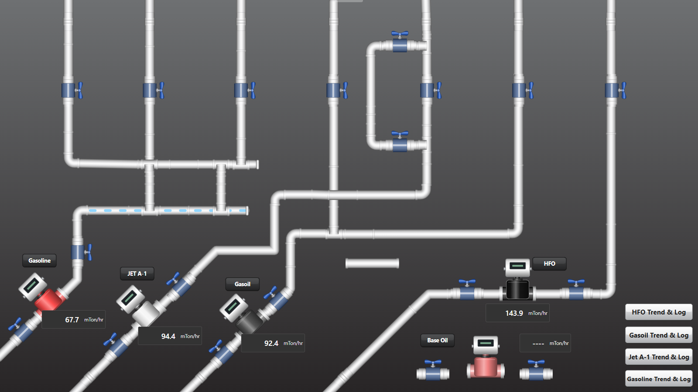

# Moviclone

A Rust + web re-implementation of a Movicon.NExT-style SCADA/HMI: one typed
project model in small TOML files, a validating build step, and a single runtime
process that runs the Modbus drivers, historian, alarm engine, operator HMI and a
browser-based designer (studio). Operators and engineers coming from Movicon NExT
find the same layout and vocabulary; everything is drawn and named by us.
Background and design: [docs/movicon-next-architecture.html](docs/movicon-next-architecture.html).



## Run the demo

```powershell
.\scripts\run-demo.ps1
```

This builds the release binaries, checks `demo/oxoafrica` with `movi build`, and
runs it with the Modbus simulator and the studio API:

- HMI: http://127.0.0.1:8080/hmi/ (Manifold, FM_01…FM_05 panels, trend screens, alarms)
- Studio: http://127.0.0.1:8080/studio/ (edit, Ctrl+S, the running HMI reloads)

Options: `-Listen 0.0.0.0:8080` for tablets on the LAN, `-NoBuild`, `-Fresh`
(empty history and alarm journal). What the demo changes compared with the
imported project, and why its alarms fire, is in [demo/README.md](demo/README.md).

By hand (bash):

```bash
. scripts/env.sh
cargo run --release -p moviclone-rt -- demo/oxoafrica --simulate --studio --web web --data demo/data
```

`moviclone-rt <project> [--listen 127.0.0.1:8080] [--simulate] [--studio] [--web web] [--data <dir>] [--allow-errors]`

| Option | Meaning |
|---|---|
| `--simulate` | start the Modbus simulator on a free local port and point every modbus-tcp driver at it (project files unchanged) |
| `--studio` | mount `/api/studio/…`; saves are applied to the running project (see *Hot reload*) |
| `--data` | historian database and alarm journal/state (default `<project>/data`) |
| `--allow-errors` | start, and apply studio saves, even when `movi build` would report errors |
| `--features mssql` (build) | forward history and data-logger rows to SQL Server (secrets via `MOVICLONE_SECRET_<NAME>`) |

`RUST_LOG` sets the log level (default `info,tokio_modbus=warn`). Ctrl+C stops
cleanly: WebSocket sessions close, the historian commits its last batch, the alarm
engine saves its state, drivers disconnect.

## Status

| Phase | Scope | Status |
|---|---|---|
| 1 | Importer (`.UFProject`, tags, drivers, screens, data config) and typed model, `movi build` validation and Modbus poll plan | done |
| 2 | Runtime core: Modbus TCP driver, simulator, tag store, HTTP/WebSocket gateway | done |
| 3 | Operator HMI (`web/hmi`) and shared renderer/symbol library (`web/shared`) | done |
| 4 | Historian (redb store-and-forward, trends, history tables, optional SQL Server forwarding) and ISA-18.2 alarm engine | done |
| 5 | Studio (`web/studio` + `crates/studio`), integration in one runtime with hot reload, demo, end-to-end tests | done |

## Architecture

```text
                      browser: /hmi/  /studio/  (plain ES modules, no build step, works offline)
                                   │  REST + one WebSocket (docs/PROTOCOL.md)
┌──────────────────────── moviclone-rt (one process) ─────────────────────────────┐
│ RouterSwitch ─► gateway (bundle, values, write, diagnostics, /ws, static files) │
│                  ├─ /api/studio/…   studio: validated, atomic TOML saves ──┐    │
│                  └─ /api/history…, /api/alarms… ─► RouterSwitch ─► services│    │
│                                                                             │    │
│ core:      TagStore ◄── Modbus TCP drivers ◄──► devices or simulator        │    │
│ services:  historian (redb, data/historian)  alarm engine (data/alarms)     │    │
│ reload:    studio save ─► reload project ─► smallest restart ◄─────────────┘    │
└──────────────────────────────────────────────────────────────────────────────────┘
```

### Crates

| Crate | Purpose |
|---|---|
| `crates/model` | serde types for the project folder, load/save; the JSON bundle is `Project` |
| `crates/check` | cross-file validation (`E…` errors, `W…` warnings, `N…` notes) and the Modbus poll planner |
| `crates/import-movicon` | reads `.UFProject`, `Server.UFUAServer`, driver settings and the screen file family |
| `crates/movi` | the CLI: `import`, `build [--plan]`, `bundle` |
| `crates/tagdb` | in-memory tag store: value/quality/timestamp per tag, change bus, write routing |
| `crates/driver-modbus` | Modbus TCP client: planned block reads, typed decode, writes (FC5/6/15/16/22), per-station back-off |
| `crates/sim` | Modbus TCP simulator modelling a loading manifold (flow, density, temperature, totals, pressure) |
| `crates/gateway` | axum HTTP + WebSocket server: bundle, values, writes, diagnostics, batched live values, static files |
| `crates/historian` | store-and-forward journal on redb, downsampled trend queries, history tables, data loggers, SQL Server forwarder (`mssql` feature) |
| `crates/alarms` | ISA-18.2 alarm engine: conditions, delay, deadband, ack, shelving, journal, persisted state |
| `crates/studio` | studio backend: read/write project files with validation and atomic writes |
| `crates/rt` | the `moviclone-rt` binary/library: wires everything together, hot reload, end-to-end tests |

### Web

| Folder | Purpose |
|---|---|
| `web/shared` | renderer (SVG screens, rotation, quality/stale states, flow animation), symbol library drawn in code, WebSocket client, trend, history table, alarm list, theme |
| `web/hmi` | operator runtime: auto-hiding top bar with alarm banner, floating panels for small screens, screen navigator, alarm page, touch/zoom, `?mock` offline mode |
| `web/studio` | designer in the Movicon NExT layout: Project Explorer, tabbed documents, screen editor (snap, guides, align, undo/redo), property grid, ToolBox, Symbol Library, tags/alarms grids, Problems, Ctrl+K palette, live values on the canvas |

### Hot reload (studio saves)

Every studio save bumps a reload counter. The runtime waits until saves pause for
400 ms, re-reads the project from disk, checks it, and applies the smallest
restart that is correct:

| What changed | What happens |
|---|---|
| screens, project settings | served project swapped; drivers, historian, alarms keep running |
| alarms, historians, data loggers, databases | historian and alarm engine restart on the same tag store; their journals are kept; drivers keep running |
| tags or drivers | new tag store, drivers (and simulator) start, the gateway switches over, the old drivers stop; historian and alarm engine restart |

Clients always get `{"type":"reload"}` and refetch `/api/bundle`; after a tag or
driver change their WebSocket is also closed and they reconnect. A project that
does not load, or has check errors without `--allow-errors`, is not applied: the
runtime keeps the previous version and logs why (the studio shows the same
diagnostics). Details: `crates/rt/src/reload.rs`.

## Project layout

```text
project.toml          name, main screen, sampling, report names, origin
tags.toml             [[tag]] name, type, access, address, historian
alarms.toml           [[alarm]] name, tag, when, limit, deadband, delay_s, severity, message
data.toml             [[database]] [[historian]] [[logger]]
drivers/<name>.toml   one driver instance (modbus-tcp: host, stations)
screens/<name>.toml   one screen: size, background, [[element]] …
```

Passwords can't be stored in these files: `password` only accepts a
`secret://name` reference (resolved from `MOVICLONE_SECRET_<NAME>`), and anything
else fails to load.

## Other commands

```powershell
. .\scripts\env.ps1                 # puts cargo and MSYS2 binutils on PATH (this machine)
cargo build --release
.\target\release\movi.exe import "C:\path\to\Project.UFProject" -o out\project
.\target\release\movi.exe build out\project --plan
.\target\release\movi.exe bundle out\project -o bundle.json
```

`movi import` writes the project plus `IMPORT-REPORT.md` (every assumption,
problem and skipped item) and `secrets.example.toml` (secrets to provide).
`movi build` resolves every reference, prints diagnostics and the Modbus poll
plan, and exits non-zero on errors (`--deny-warnings` makes warnings fail too).

## Tests

```bash
. scripts/env.sh
cargo test --workspace                  # unit, integration and end-to-end tests
cargo clippy --workspace --all-targets
```

- `crates/rt/tests/e2e.rs` starts the whole runtime with the simulator on
  ephemeral ports and checks: bundle and static pages, WebSocket values with good
  quality, a coil write round trip, history points and history tables, an alarm
  activating and being acknowledged (WebSocket feed, REST, journal on disk), and
  studio saves of a screen, the alarms and the tags each triggering
  `{"type":"reload"}` with the right restart (and a broken save not being applied).
- Browser tests: `web/shared/tests.html` and `web/studio/tests.html` (serve `web/`
  and open them; the page title shows PASS/FAIL).
- `cargo test -p moviclone-import-movicon` imports the synthetic project in
  `crates/import-movicon/tests/fixtures/Mini`; set `MOVICON_PROJECT` to also
  import a real one.

## What the importer maps

| Movicon | Moviclone |
|---|---|
| `UFUATag` + `DynamicSettings` (`Station=…\|LinkType=…\|FC=…\|SA=…`) | `[[tag]]` with a typed `address`; FC codes from `ModbusTCP.FunctionCodes`, LinkType from `DriverCodeBase` |
| `ModbusTCP.drvSettings` channel + stations | `drivers/<channel>.toml` |
| historian / data-logger connection strings | `[[database]]` with `secret://` password, plus `[[historian]]` / `[[logger]]` |
| `Screen/*.xaml` + `.xaml.Settings` + `.svg` + `.controls` + `.references` + `.commands` | `screens/<name>.toml` (labels, displays, buttons, pipelines, symbol placeholders, click commands) |

Not imported yet: alarms, events, scheduler, recipes, users, logic, report
layouts (names only), symbol graphics (encrypted by Movicon; replaced by our own
symbol library through `web/shared/symbol-map.json`), trend controls.

## Known gaps

- **Security**: no users, log-in or access levels; anyone who reaches the port can
  write tags, acknowledge alarms and edit the project. Bind to `127.0.0.1` or a
  trusted network. No TLS on the HTTP server. Pages from other sites cannot
  write, acknowledge or edit through an operator's browser: state-changing
  requests and WebSocket upgrades with a foreign `Origin` get 403, and `/api/`
  bodies must be `application/json`. Behind a reverse proxy with another host
  name, list it in `MOVICLONE_ALLOWED_ORIGINS` (comma-separated, e.g.
  `https://scada.example.com`).
- **Drivers**: Modbus TCP only. A device that rejects a merged block read is not
  split into single reads automatically.
- **Hot reload**: any tag change (even a description) restarts drivers and the
  simulator (the tag store is indexed by the tag list); simulator totals restart.
  Hand edits of the TOML files are not picked up until the next studio save or a
  restart (no file watcher).
- **History**: only a SQL Server forwarder (feature `mssql`, untested against a
  real server here); the SQL table layout is our own, not Movicon's.
- **Studio**: drivers, historians, loggers and databases are read-only (no studio
  routes for them yet); fonts, visibility and user access are not in the model;
  report layouts cannot be edited; undo of a rename spanning documents takes one
  step per document.
- **HMI / imported screens**: the demo has no Base Oil (removed from the imported
  Manifold screen, see `demo/README.md`, change 3).
  Some imported displays are bound to other meters' tags as in the source project
  (e.g. the HFO display next to FM_04 shows `FM_01_Volume_Rate`, panel `FM_01`
  is titled "HFO"); `movicon:Symbol732` is a best-guess pipe.
- **Reports, events, schedulers, recipes, scripts/logic**: not implemented.
