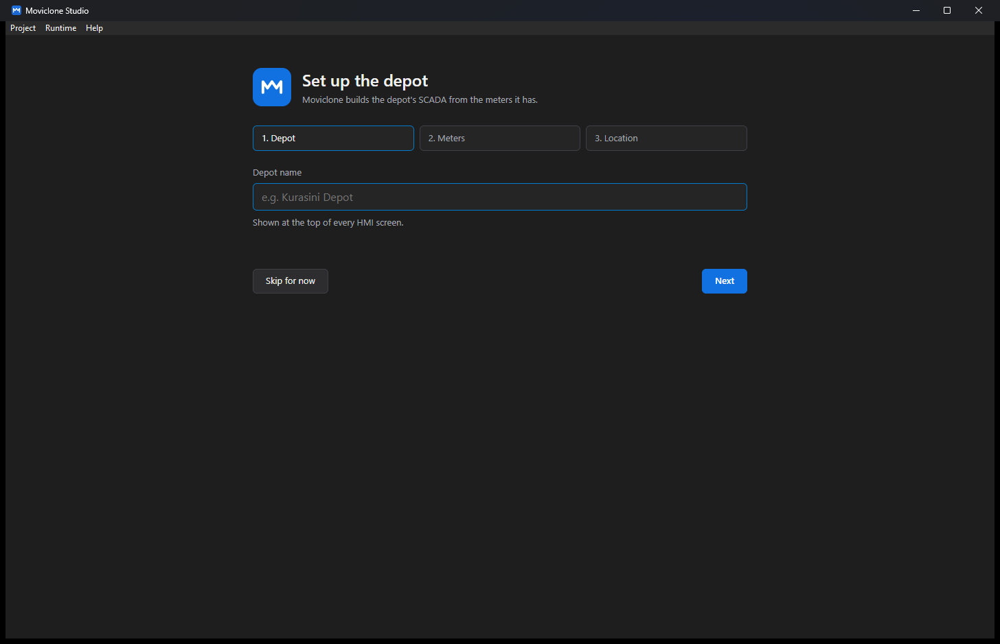
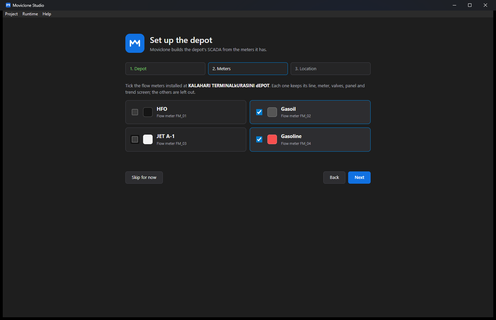

# Moviclone Studio desktop app (Windows, macOS)

An installable Moviclone Studio: the studio, the operator HMI and the runtime
(Modbus drivers or the simulator, historian, alarms, sign-in) in one program
built with [Tauri](https://tauri.app). Nothing else has to be installed or
started.

- **First start: depot setup.** The first time the installed app opens it
  asks for the **depot name** (shown at the top of every HMI screen), the
  **meters installed at the depot** (HFO, Gasoil, JET A-1, Gasoline; any one to
  four) and where to keep the project (`Documents\Moviclone\<depot>` unless
  changed). It builds the depot's SCADA from the bundled OXOAFRICA template:
  the chosen meters keep their lines, meters, valves, panels, trend screens,
  alarms and history in the existing Manifold layout, and the others are left
  out (see `demo/site-template.toml`). The project then opens in the studio.
  *Skip for now* goes to the launcher; *Set Up a Depot…* (launcher or Project
  menu) runs the setup again for another depot.
  
  
- **Launcher**: recent projects, *Set Up a Depot…*, *Open Project…*, *New
  Blank Project…* (an empty folder; one blank 1920×1080 screen), *Import
  Movicon.NExT…* (a `.UFProject` into an empty folder, with `IMPORT-REPORT.md`).
- **Studio**: the window shows the studio of the open project, served by the
  runtime inside the app on `127.0.0.1` (port 47801, or the next free one).
- **Menus**: *Project* (set up a depot, open, new, import, close, show folder), *Runtime*
  (*Use the Simulator* on/off, *Open HMI Window* F6, HMI or studio in the
  browser, data folder, log file), *Help*. macOS also gets the usual app and
  Edit menus.
- **Sign-in**: as with `moviclone-rt`. On first use of a project the studio
  offers to create its administrator (the app talks to its own runtime over
  loopback).
- **Data per project** (history, alarm journal and state, `users.toml`) in the
  app's data folder, not in the project folder:
  - Windows: `%APPDATA%\com.moviclone.studio\projects\<name>-<id>\`
  - macOS: `~/Library/Application Support/com.moviclone.studio/projects/<name>-<id>/`
- **Settings** (recent projects, simulator on/off): `settings.json` in the
  app's config folder. **Log**: `moviclone.log` in the app's log folder
  (*Runtime › Show Log File*).
- A project folder given on the command line opens at once
  (`"Moviclone Studio.exe" "D:\Projects\Plant A"`), e.g. from a shortcut.
- Closing the window or the project asks first, because unsaved studio edits
  live in the page: save them (Ctrl+S / Save All) before.

The simulator is on by default, since an engineering PC rarely reaches the
plant's devices; switch it off in the launcher or *Runtime › Use the Simulator*
to connect the project's drivers to the real devices (the project restarts).

## Installers (GitHub Actions)

`.github/workflows/desktop.yml` builds them on GitHub's Windows and macOS
runners:

```powershell
git tag v0.2.0
git push origin v0.2.0
```

The tag's number becomes the app version, and a **draft release** with the
installers is created: `Moviclone Studio_0.2.0_x64_en-US.msi`,
`Moviclone Studio_0.2.0_x64-setup.exe` and
`Moviclone Studio_0.2.0_universal.dmg`. Check them, then publish the release.
*Actions › Desktop installers › Run workflow* builds them without a release
(download them from the run's artifacts).

The Windows installers download Microsoft's WebView2 runtime when a PC lacks
it (Windows 10 and 11 normally have it).

## Signing

Without signing the installers work, but Windows SmartScreen warns
("Windows protected your PC" › More info › Run anyway) and macOS refuses the
first start until it is allowed in *System Settings › Privacy & Security*.

- **macOS** (Apple Developer Program): add repository secrets
  `APPLE_CERTIFICATE` (the Developer ID Application certificate as a base64
  `.p12`: `base64 -i cert.p12 | pbcopy`), `APPLE_CERTIFICATE_PASSWORD`,
  `APPLE_SIGNING_IDENTITY` (e.g. `Developer ID Application: Name (TEAMID)`),
  and for notarization `APPLE_ID`, `APPLE_PASSWORD` (an app-specific password)
  and `APPLE_TEAM_ID`. The workflow uses them when they are set.
- **Windows**: a code-signing certificate (an EV or Azure Trusted Signing
  certificate avoids SmartScreen warnings at once). Configure it as described
  in Tauri's *Windows code signing* guide (`bundle.windows.signCommand` or a
  certificate thumbprint) and add its secrets to the workflow.

## Building on a PC

Needs Rust and the Tauri CLI (`cargo install tauri-cli --version "^2" --locked`).

- **Windows**: the MSVC toolchain (Visual Studio Build Tools, "Desktop
  development with C++") is what Tauri supports for installers. The repository's
  usual GNU toolchain (`scripts/env.ps1`) builds and runs the app for
  development (`cargo run` in `desktop/`), but use MSVC or the workflow for
  installers.
- **macOS**: Xcode command line tools (`xcode-select --install`).

```powershell
cd desktop
cargo run                  # the app, with the repository's web/ folder
cargo tauri build          # installers in desktop/target/release/bundle/
cargo test                 # new project, recent list, data folders
```

`desktop/` is a Cargo workspace of its own (excluded from the main one), so
Tauri's dependencies stay out of the main builds and tests. Icons are drawn by
`icons/make_icons.py` (no dependencies; run it after changing the mark).
